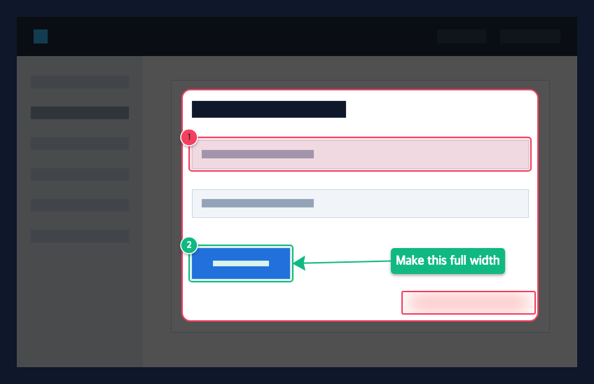

# Agent usage

Annot8 can be driven by AI agents and scripts as a **parametric** screenshot editor: annotations are described as data (an Annot8 *spec*), rendered headlessly, inspected, and adjusted. Everything runs locally. There are three ways in:

| Surface | Use it when | How |
|---|---|---|
| **CLI** (`annot8`) | Scripts, CI, any agent with a shell | `npm run build:cli && npm link` |
| **MCP server** (stdio) | Agents that speak MCP (Claude Code, Claude Desktop, …) | `annot8 mcp` as a local subprocess. No network listener. |
| **Browser bridge** (`window.annot8`) | Agents that drive Chrome, or handing a result to a person to tweak | Open the app; call `window.annot8.*` |

All three use the same spec, compiler, and renderer (Canvas2D in the browser, `@napi-rs/canvas` in Node), so a spec renders the same everywhere.



## The spec

`docs/examples/sample.annot8.json` produced the image above:

```json
{
  "version": 1,
  "image": { "source": "../../tests/fixtures/screen.png" },
  "frame": { "padding": 24, "background": "#0F172A" },
  "defaults": { "color": "#F43F5E" },
  "annotations": [
    { "type": "highlight", "x": 236, "y": 104, "width": 508, "height": 330, "radius": 12 },
    { "id": "email", "type": "box", "x": 246, "y": 172, "width": 488, "height": 48, "note": "Email field has no label" },
    { "id": "submit", "type": "box", "x": 246, "y": 326, "width": 148, "height": 52, "color": "green", "note": "Primary action" },
    { "id": "hint", "type": "text", "at": { "anchor": "@submit.right", "dx": 140, "dy": -22 }, "text": "Make this full width", "color": "green" },
    { "type": "arrow", "from": "@hint.left", "to": "@submit.right", "color": "green", "badge": false },
    { "type": "blur", "x": 550, "y": 392, "width": 190, "height": 32 }
  ]
}
```

- **Coordinates** are pixels in the original image, or percentage strings: `"25%"` of the width for `x`/`width` and of the height for `y`/`height`.
- **Annotation types**:
  - `box`, `ellipse`, `highlight` (spotlight), and `blur` (redaction) take `x, y, width, height`.
  - `arrow` takes `from, to`.
  - `pin` takes `at`.
  - `text` takes `at, text, fontSize?, align?`.
- **Points** (`from`, `to`, `at`) can be `[x, y]`, an anchor such as `"@submit"` or `"@submit.right"`, or `{ "anchor": "@submit.right", "dx": 20, "dy": -10 }`. The anchor positions are `center`, `top`, `bottom`, `left`, `right`, `top-left`, `top-right`, `bottom-left`, and `bottom-right`. Anchors can point forward to an annotation declared later. They are resolved at compile time, so if `submit` moves, everything anchored to it moves too.
- **Numbering**: `box`, `ellipse`, `arrow`, and `pin` get badges 1..N in list order. Set `"badge": false` to hide one; it still keeps its number. `highlight`, `blur`, and `text` are unnumbered.
- **Colors**: `red`, `amber`, `green`, `cyan`, `purple`, or any hex such as `"#F43F5E"`. Badge text color is chosen automatically for contrast.
- **Frame**: `crop` (`x, y, width, height`) is applied first, then `padding` with a `background` color.
- **Image source** can be a path (relative to the spec file), an http(s) URL, or a data URL. The browser bridge cannot read local paths.

The full JSON Schema comes from `annot8 schema` (or `annot8 schema ops` for edit operations). Validation errors are path-addressed, so an agent can fix its own input:

```json
{ "error": "invalid_spec", "issues": [{ "path": "annotations[3].at", "message": "Unknown anchor target \"@sumbit\"" }] }
```

## Edit ops

Ops edit the spec, not the pixels, so anchors stay live:

```json
[
  { "op": "update", "id": "submit", "set": { "x": 300, "color": "#22C55E" } },
  { "op": "add", "annotation": { "type": "pin", "at": "@email.top-right", "note": "Needs a label" } },
  { "op": "reorder", "id": "submit", "index": 0 },
  { "op": "delete", "id": "a3" },
  { "op": "setFrame", "frame": { "crop": { "x": 200, "y": 70, "width": 580, "height": 400 } } },
  { "op": "clear" }
]
```

In `update.set`, `null` removes a field. Annotations without an `id` get stable ids (`a1`, `a2`, …) the first time ops are applied, and new ids are returned as `addedIds`.

## CLI

```bash
npm run build:cli && npm link          # installs the `annot8` command locally

annot8 inspect shot.png                # {"width":2880,"height":1800}: placing coordinates needs this
annot8 init shot.png                   # writes shot.annot8.json with the image dimensions
annot8 render shot.annot8.json -o out.png --md notes.md [--scale 2]
annot8 validate shot.annot8.json       # exit 1 with path-addressed issues on stderr
annot8 apply shot.annot8.json --ops '[{"op":"update","id":"submit","set":{"x":300}}]' --in-place
annot8 schema [spec|ops]
```

Output is JSON on stdout. Errors are JSON on stderr, with exit code 1 for an invalid spec or failure and 2 for a usage error. Pass `-` instead of a file name to read the spec from stdin.

## MCP server

The project `.mcp.json` already registers the server for Claude Code after `npm run build:cli`. For other clients:

```json
{ "mcpServers": { "annot8": { "command": "node", "args": ["/path/to/anotato/dist-cli/annot8.js", "mcp"] } } }
```

Tools:

- `annot8_schema`: a usage guide plus the spec and ops JSON Schemas. Call this first.
- `annot8_inspect_image`: image dimensions.
- `annot8_validate`: path-addressed issues.
- `annot8_apply_ops`: returns the new spec. Pass `write: true` to update `specPath` in place.
- `annot8_render`: writes the PNG to `output` and **returns the rendered image** (downscaled to 1568px on the long side), so the agent can look at its own edit and correct it in the same loop.

Each tool takes either an inline `spec` object or a `specPath`.

## Browser bridge

With the app open (`npm run dev`, or the installed PWA), `window.annot8` exposes:

| Method | Description |
|---|---|
| `schema()` | `{ spec, ops }` JSON Schemas |
| `loadSpec(spec)` | Loads a spec (http(s) or data URL image). If the image is already on the canvas, only annotations change. |
| `apply(ops)` | Applies edit ops. Returns `{ addedIds, spec }`. |
| `getSpec({ embedImage? })` | The current document. Pasted images (`blob:`) are embedded as data URLs. |
| `render()` | Composite PNG as a data URL, exactly what Export produces |
| `markdown()` | The notes as markdown |

Agent edits go through the normal undo history, so a person can press ⌘Z to revert them. Anchors stay live until someone edits the canvas by hand or presses undo. After that, the spec is derived from what is on screen, in pixels. Frame changes are not part of undo history.

People can also:

- drop or paste a `.annot8.json` file (or spec JSON text) onto the app
- open a link like `https://…/#spec=<base64url JSON>`; the hash never leaves the browser
- use **Save spec** (the file-with-braces icon at the end of the export toolbar) to download the current document as `.annot8.json`

## Notes and limits

- Text uses system sans-serif fonts. Label widths may differ by a few pixels between machines, and the golden image tests allow for this.
- Badge size scales with the source image size, not the cropped output.
- There are no interactive tools for text or crop yet. Both are spec-only, and text labels can be moved but not resized in the editor.
