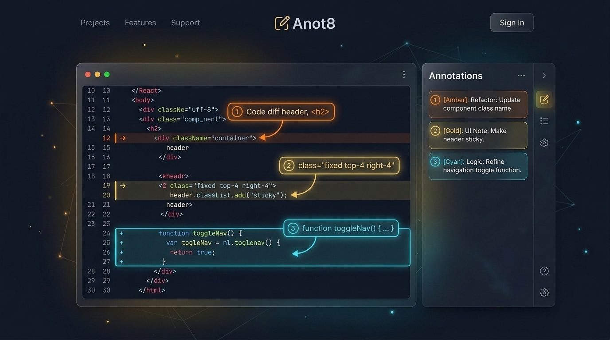

# Anot8 — Release & Deployment Report

**Anot8** is an open-source, client-side screenshot annotation and split-view Markdown note-taking application with a headless CLI, stdio MCP server, agent skill, and browser bridge for AI coding harnesses.

---

## 🔗 Repository & Live Deployment

- **GitHub Repository**: [https://github.com/ksprashu/anot8](https://github.com/ksprashu/anot8)
- **Live GitHub Pages App**: [https://anot8.ksprashu.dev](https://anot8.ksprashu.dev) (redirected from `https://ksprashu.dev/anot8`)
- **Project Banner**: Committed to [`docs/images/banner.png`](images/banner.png) and embedded at the top of [`README.md`](../README.md).
- **Agent Usage Guide**: [`docs/agent-usage.md`](agent-usage.md) and [`.claude/skills/anot8/SKILL.md`](../.claude/skills/anot8/SKILL.md).

---

## 🔒 Security & Privacy Architecture

- **Zero Credential / Token Leaks**: Audited all tracked files for API keys, passwords, bearer tokens, and internal email addresses (`0 found`).
- **Zero-Network Client Architecture**: The web app makes zero outbound external API calls during annotation or export (`tests/stress/static_bundle_autonomy.test.ts`).
- **Hardened Local MCP & CLI**:
  - Runs strictly over `stdio` as a child process with no network port listener.
  - Blocks SSRF against loopback, link-local, RFC1918/ULA private IPs, and cloud metadata endpoints (`169.254.169.254`, `metadata.google.internal`) across redirects.
  - Enforces a 50 MB image size cap, 15s fetch timeout, bounded coordinates, and 16384px / 64 MP canvas limits.

---

## 🚀 Static GitHub Pages & PWA Deployment

- **GitHub Pages Workflow**: [`.github/workflows/deploy-pages.yml`](../.github/workflows/deploy-pages.yml) runs `npm run typecheck`, `npm run build`, and `npm test` before publishing `dist/`.
- **Installable Offline PWA**: Workbox service worker precaches the app shell (`index.html`, hashed JS/CSS, icons, `manifest.webmanifest`) and prompts before applying updates so active annotations are never lost.

---

## 🤖 Parametric Spec, CLI, MCP Server & Agent Skill

- **Spec (`src/spec/`)**: Declarative `.anot8.json` v1 schema supporting pixel and percentage coordinates, `@id.<position>` anchors, custom hex colors, text labels, spotlight highlights, destructive blur redactions, and crop/padding frames.
- **CLI (`cli/anot8.ts`)**: `inspect`, `init`, `render`, `markdown`, `validate`, `apply`, `share`, `schema`, and `mcp`.
- **MCP Server (`cli/mcp.ts`)**: Exposes 8 tools (`anot8_schema`, `anot8_inspect_image`, `anot8_init_spec`, `anot8_validate`, `anot8_apply_ops`, `anot8_render`, `anot8_markdown`, `anot8_share_url`), 3 resources, and 2 prompts over stdio.
- **Agent Skill (`.claude/skills/anot8/SKILL.md`)**: Guides agents through the closed-loop visual self-check workflow.

---

## 🧪 Comprehensive Verification Summary

| Verification Track | Scope / Command | Result |
|---|---|---|
| **Vitest DOM & Node Projects** | `npm test` (84 test files) | **1502 / 1502 passed (100%)** |
| **Headless Node Suite** | `npx vitest run --project node` | **Golden renders, CLI, MCP, SSRF guards passed** |
| **Standalone 4-Tier E2E** | `npx tsx tests/e2e/test-runner.ts` | **315 / 315 passed (100%)** |
| **TypeScript Typecheck** | `npm run typecheck` | **0 errors** |
| **ESLint** | `npm run lint` | **0 errors** |
| **Production & CLI Build** | `npm run build && npm run build:cli` | **Clean bundles in `dist/` and `dist-cli/`** |
